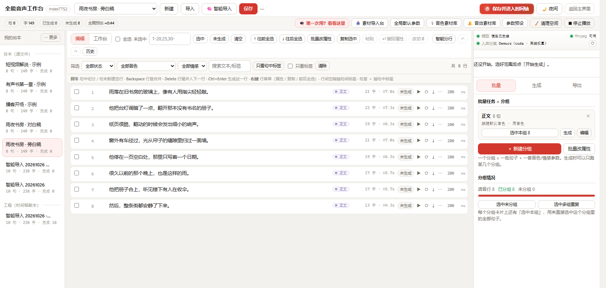
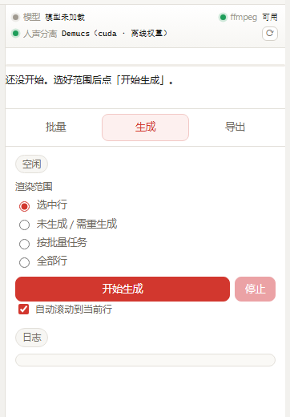
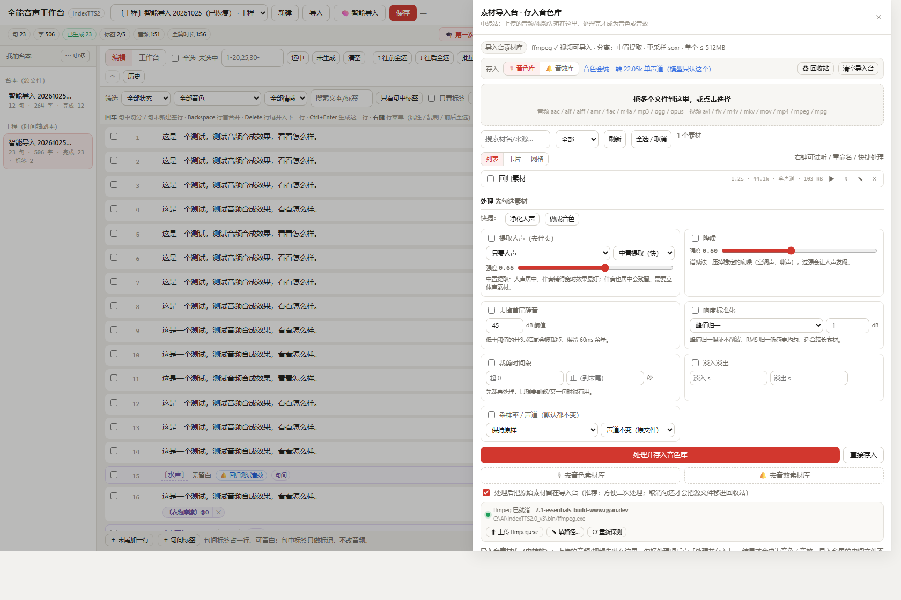
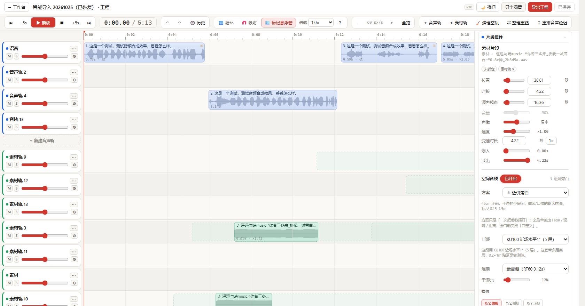
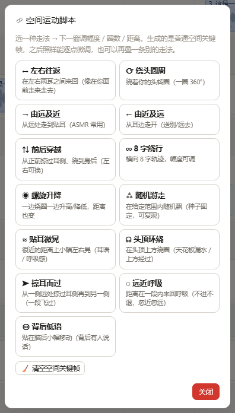
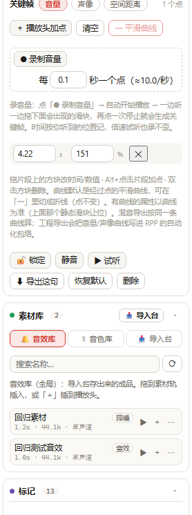
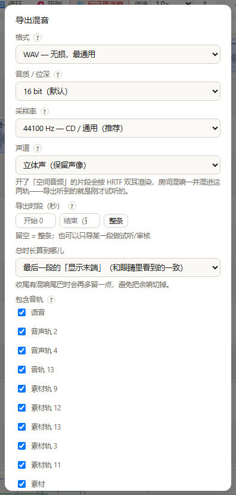
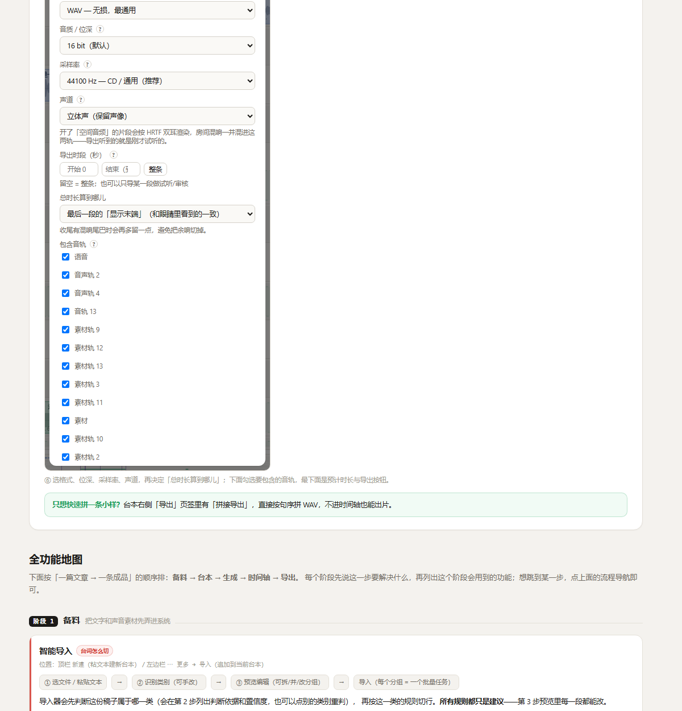

# 全能音声工作台 · IndexTTS2 长篇台本与全流程音声制作扩展

**从一份台本，到一部完整的音声作品。**

长篇台本管理、批量 AI 配音、多轨时间轴、音效编排、空间音频、自动化混音、专业工程导出 —— 将原本分散在多个软件和繁琐手工操作中的音声制作环节，整合进一套连贯的工作流。

本项目基于 **IndexTTS2.0 超级优化整合包 V3** 开发，为其扩展长篇台本工作台与多轨音频制作能力。它不是独立的 TTS 模型，也不只是一个批量配音工具，而是面向**有声书、广播剧、ASMR、角色音声、游戏语音及视频解说**等场景的全流程音声制作工作台。

<sub>当前版本 v1.9 · 2026-10-26 · Windows 便携整合包 · MIT（仅本项目代码）· 简体中文界面</sub>

> ⚠️ **这是扩展补丁，不是独立软件。** 必须先安装整合包 V3（提供模型与运行时），本仓库只提供工作台这一层代码。
> 整合包的下载方式与原作者信息见下方 [关于原项目与版权](#-关于原项目与版权)。

---

## ✨ 核心功能：从一份台本，到一部完整的音声作品

不止是 AI 配音。台本整理、批量生成、素材处理、多轨剪辑、空间音频、自动化混音与专业工程导出，一套工作流覆盖音声制作的主要环节。

### 01 · 整理台本，让长篇创作变得可控

再长的文稿，也能拆解成清晰、可管理、可批量处理的配音任务。

- **智能识别与分句** —— 支持时间轴稿、剧本、小说、指令和纯文本等不同类型的文稿，提供多种分行方案，可调整单段长度、分组方式和句间停顿。
- **灵活组织内容** —— 按章节、角色、场景或指定段数分组，支持逐段预览、拆分、合并和修改。
- **批量管理与重做** —— 支持单句生成、选中行批量生成、未生成内容补全及全文生成；可按状态、音色和分组筛选，并快速定位修改过的句子。
- **句内音效标记** —— 在指定文字之后或两句之间添加音效标记，设置延迟与留白，为后续时间轴编排做好准备。

<p align="center"></p>

### 02 · 批量 AI 配音，逐句生成、试听与重做

让每一句台词都能独立管理，不必因为局部修改而反复处理整篇作品。

- **逐句独立生成** —— 每行台词对应独立的音频结果，可单独试听、重新生成和检查实际时长。
- **角色与音色管理** —— 按分组配置音色和情感参数，让不同角色、章节或场景采用各自的配音设置。
- **灵活批量生成** —— 可针对选中行、尚未生成的句子或全部台词执行生成，方便长篇内容分批制作。
- **修改追踪** —— 快速查看文本或生成状态发生变化的句子，减少查找与重复劳动。
- **多选与批量操作** —— 支持连续或非连续多选、批量删除和复制；复制句子时可连同已有音频一起复制。

<p align="center"></p>

### 03 · 导入与处理素材，建立自己的音色库和音效库

不只处理生成出来的声音，也能把已有录音、环境音和视频素材纳入制作流程。

- **多种素材导入** —— 支持音频和视频素材，视频可提取音轨作为后续处理的原始素材。
- **常用音频处理** —— 提供去伴奏、中置提取、降噪、响度标准化与音频裁剪等功能。
- **素材分类沉淀** —— 将处理后的音频保存到音色库或音效库，供后续配音和时间轴工程复用。
- **保留原始素材** —— 默认保留原文件，便于重新处理、调整参数和制作不同版本。

<p align="center"></p>

### 04 · 多轨时间轴，把台词和音效真正编排起来

从一条条独立音频，进入可以自由调整的多轨音声工程。

- **多轨素材编排** —— 分轨管理配音与音效等素材，支持拖拽移动、裁剪、框选、多选及整组移动。
- **台本与时间轴衔接** —— 从台本工作台创建工程副本，将句子和已有音频带入时间轴；原台本保持不变。
- **快速重排台词** —— 根据台本句序与句间停顿，重新排列分散在多条音声轨上的片段，只调整开始时间，不必重新生成音频。
- **精确调整片段** —— 可编辑片段位置、时长、源音频起点、音量、声像、淡入淡出和播放速度。
- **灵活控制时长** —— 支持变速播放，也可将音频调整到指定时长，方便匹配画面、动作和音效节点。

<p align="center"></p>

### 05 · 句内音效与空间音频，设计声音的距离和运动

不只是把声音放进时间线，还能控制它从哪里出现、如何移动，以及听起来处于怎样的空间。

- **精准插入音效** —— 台本中标记的句内位置、句间位置和延迟设置，可在进入时间轴时转换为对应的素材片段。
- **空间定位** —— 基于 HRIR 数据进行空间音频处理，支持方位、仰角和距离控制。
- **房间混响** —— 提供房间混响与干湿比调节，为声音增加空间感。
- **运动脚本预设** —— 内置 13 种运动脚本，可快速生成左右往返、绕头圆周、掠过耳侧、头顶环绕、背后低语等空间运动效果。
- **关键帧曲线** —— 为方位、仰角、距离等空间参数设计随时间变化的轨迹，塑造连续的声音运动。

<p align="center"></p>

### 06 · 自动化控制与实时录制，让声音随时间变化

让音量、声像和空间位置不再是固定参数，而是可以随着剧情与听感动态变化的控制曲线。

- **三类自动化曲线** —— 支持音量、声像和空间距离关键帧。
- **边听边调整** —— 播放过程中操作控制滑杆，可将实时调整记录为关键帧。
- **精细塑造声音** —— 通过参数随时间变化，制作音量渐强渐弱、左右声道移动及距离远近变化等效果。

<p align="center"></p>

### 07 · 混音与工程导出，将制作成果交给专业软件

既能直接输出成品，也能保留可继续编辑的工程结构。

- **多格式混音** —— 支持 WAV、MP3、FLAC、OGG，可配置采样率、声道、导出时段和指定轨道。
- **REAPER 工程** —— 导出包含片段位置、裁剪、音量、声像、淡入淡出及自动化信息的工程，便于继续后期制作。
- **视频后期衔接** —— 支持导出 PR / 达芬奇 EDL，方便衔接视频剪辑工作流。
- **Audacity 工作流** —— 导出分轨 WAV 与标签，便于检查、修整和继续编辑。
- **完整素材交付** —— 可附带分轨 stems、`timeline.csv` 和 `markers.csv`，方便归档、复用和二次处理。
- **灵活控制导出范围** —— 可选择指定轨道与时间段，并按显示末端或未显示末端计算导出总时长。

<p align="center"></p>

### 08 · 内置离线教程，从首次使用到完整制作

不必反复查阅外部文档，工作台自带完整的操作指引。

- **六步上手流程** —— 从素材准备到最终导出，快速了解基本制作步骤。
- **完整功能索引** —— 按备料、台本、生成、时间轴、导出五个阶段组织功能说明。
- **快捷键与常见问题** —— 方便查找操作方法和排查常见问题。
- **离线阅读** —— 教程页面与配图随补丁提供，无需联网访问。

<p align="center"></p>

从台本到配音，从音效到空间运动，再到混音与工程交付 —— 这就是全能音声工作台希望提供的完整制作流程。

---

## 📦 项目性质

- **项目类型** —— IndexTTS2 扩展补丁，依赖 IndexTTS2.0 超级优化整合包 V3 运行，不是独立的 TTS 软件。
- **主要平台** —— Windows 便携整合包环境，提供简体中文界面。
- **核心用途** —— 长篇台本管理、批量语音生成、音效编排、空间音频、自动化混音与工程导出。
- **仓库内容** —— 只有工作台这一层代码（台本编辑器 / 时间轴 / 混音与工程导出 / 教程），
  **不含**模型、运行时与整合包本体。

## 🛠 关于本项目的开发

本项目的开发主要由我负责整体方向规划、功能构思、需求整理与开发指导，具体的代码编写和功能实现则大量借助 AI 工具 **DeepSeek** 完成。

如果你在使用过程中遇到问题，欢迎提交反馈；如果涉及我暂时无法独立解决的技术问题，可以尝试借助 AI 工具分析报错、排查问题或修改代码，也可以参考项目文档自行解决。

如果问题涉及基础整合包、模型或推理环境，建议优先向原作者 **十一君Jun** 请教。

本项目是个人业余项目，开发与维护能力有限，无法保证所有问题都能及时解决，还请见谅。

## 💛 关于原项目与版权

本项目仅提供扩展工作台相关功能，**不包含也不拥有**基础整合包、IndexTTS2 模型与推理代码的版权。相关组件及第三方素材均遵循各自的许可协议，具体请参阅 [LICENSE](LICENSE)、[CREDITS.md](CREDITS.md) 及相关说明文件。

基础整合包（**IndexTTS2.0 超级优化整合包 V3**，作者：B 站 **十一君Jun**）及其相关问题，请优先参考原作者发布的信息：

- GitHub：<https://github.com/lfandrh/indextts2-studio>
- B 站主页：<https://space.bilibili.com/470166715/>
- 整合包相关视频：<https://www.bilibili.com/video/BV18AJX6SEBN/>

原作者提供的整合包下载（以下链接按作者公开信息整理，**请以原作者发布页为准**）：

| 网盘 | 链接 |
|---|---|
| 夸克网盘 | <https://pan.quark.cn/s/9cd4d7d5dfa9> |
| 百度网盘 | <https://pan.baidu.com/s/1dTd34exfqdGWtVPTD566fQ?pwd=2333> （提取码 `2333`） |
| 123 网盘 | <https://1833900014.share.123pan.cn/123pan/nkiATd-LtDpH> |

> 如果你是第一次知道这个整合包：**请先感谢并支持原作者**。整合包本体的一切问题（模型、显存、安装、更新）
> 都应该去原作者那边反馈，而不是本仓库。
>
> 感谢原作者 **十一君Jun** 提供的基础整合包，也感谢 **DeepSeek** 等 AI 工具在本项目开发过程中提供的帮助。

---

## 🚀 快速开始

### 方式一：装补丁包（推荐，最省事）

1. 先准备一个 **IndexTTS2.0 超级优化整合包 V3**（见上方[下载链接](#-关于原项目与版权)），确认能正常启动；
2. 下载本仓库 [Releases](https://github.com/Mars-1438/indextts2-longform-workbench/releases) 里的
   `indextts2-longform-workbench-patch-vX.Y.zip`（约 119MB）；
3. 把 zip **解压到整合包根目录**（和 `server.py`、`runtime\` 同级），会多出一个 `IndexTTS2_全能音声工作台补丁_vX.Y` 文件夹；
4. 进这个文件夹，双击 **`安装.bat`**；
5. 看到「完成」后关掉窗口，重新双击整合包根目录的 `start_server.bat`；
6. 浏览器打开首页，右上角会多一个「长篇台本」入口；也可以直接访问：
   - `http://127.0.0.1:7860/longform` —— 台本工作台
   - `http://127.0.0.1:7860/timeline` —— 时间轴
   - `http://127.0.0.1:7860/guide` —— 图文教程

安装器做的事只有三件，都可以手工完成：把文件铺进整合包、在 `server.py` 里插一段扩展注册、在 `web/index.html` 里加入口。
它**不会**改你的模型、不会动既有页面（除了 `index.html` 加一行链接），失败也不会拖垮主服务。想卸载跑 `install.py --restore`。

> 补丁包里带了两样「大件」：`bin\ffmpeg.exe`（视频抽音频）和 Demucs 的 htdemucs 权重（去伴奏，离线可用）。
> 不需要的话可以删掉 `bin\` 或 `vendor2\torch\`，功能会退化成「只能导入普通音频 / 只有轻量中置提取」。

### 方式二：从源码装（想改代码 / 移植到别的包）

见 [docs/移植到其它整合包.md](docs/移植到其它整合包.md)，里面有文件清单、注册块位置、依赖和踩坑记录。

---

## 🧭 三步上手

1. **导入台本**：顶栏「新建」→ 粘贴文稿 → 选分行方案 → 预览 → 导入。
2. **选音色并生成**：音色库选参考音频（或素材导入台里存一个）→ 右侧「生成」页签 → 先试 1~2 句 → 全篇生成。
3. **进时间轴**：台本页「🎬 时间轴」会新建一份工程副本（原台本不动）→ 排位置 / 加音效 / 调空间 → 「导出混音」。

更细的流程都在工作台自带的教程里（`/guide`，点顶栏「🎓 第一次用？看看这里」）；
纯文字版见 [docs/使用说明.txt](docs/使用说明.txt)，实现细节见 [docs/技术路线_长篇台本与时间轴.md](docs/技术路线_长篇台本与时间轴.md)。

---

## 📦 目录结构（本仓库）

```
longform_api.py        台本工作台后端（FastAPI 路由 /api/v1/lf/*）
lf_import.py           智能导入：五类识别 + 分行规则
timeline_api.py        时间轴后端（路由 /api/v1/lf/tl/*、混音与工程导出）
hrir.py                SOFA / NPZ 的 HRIR 读取、打包与查询
rooms.py               房间混响（IR 生成 / 卷积）

web/                   前端
  longform.html/.css/.js    台本工作台
  timeline.html/.css/.js    时间轴
  emoctl.js                 情感控件（两个页面共用）
  guide.html + guide/*.png  内置教程与配图

assets/hrir/           HRIR 数据（KEMAR / KU100 近场；授权见该目录 README）
packaging/             补丁安装器（install.py / 安装.bat / 说明.md）
tools/
  make_patch.py           打补丁包的脚本
  fetch_ffmpeg.ps1        可选：下载 ffmpeg 到 bin/（不把二进制放进仓库）
docs/                  使用说明、技术路线、移植指南、补丁安装说明、README 配图
```

---

## ✅ 兼容性与已知限制

- **平台**：主要针对 **Windows 便携整合包**（自带 `runtime\python.exe`）。安装器与 `.bat` 是 Windows 脚本；
  Linux/macOS 需要手工铺文件 + 自己装依赖（见移植指南）。
- **Python**：3.11（整合包内置）。后端只依赖 `fastapi / numpy / soundfile`，`scipy / h5py / torch+demucs` 是可选项。
- **主程序版本**：按 IndexTTS2 v3 的 `server.py`（`app` + `api = APIRouter(...)` + `/api/v1`）写的注册逻辑；
  别的改版整合包结构不同的话要按移植指南改接线。
- **数据是纯文件**：台本 / 工程 / 素材 / 导出都在整合包的 `longform\` 与 `outputs\` 下，不写注册表、不写系统目录。
- **不做的事**：不训练模型、不替换 TTS 推理、不改主界面既有功能；工作台只是「上游 API 的编排层」。
- **性能**：空间音频 + 混响是实时渲染（numpy/scipy），一小时工程导出混音大约几分钟，具体看机器。

---

## ⚖️ 许可与使用边界

- 本仓库中**由本项目作者编写的代码**以 **MIT** 发布，见 [LICENSE](LICENSE)。
- **不包含也不授权**：IndexTTS2 模型与推理代码、十一君Jun 的整合包、Demucs 权重、ffmpeg 二进制。
  这些各自的版权与许可见 [CREDITS.md](CREDITS.md)。
- **HRIR 数据**：`assets/hrir/` 下不同文件授权不同（KEMAR 无使用限制但需引用；KU100 近场为 CC BY-SA），
  详见该目录内的 `README.md`。商用前请自行确认。
- **使用边界**：本项目用于个人创作与学习。请勿用于伪造他人声音、诈骗、侵权或任何违法用途；
  公开发布合成语音时，请遵守当地关于 AI 生成内容标识的规定，并取得声音权利人的授权。
- **免责**：软件按「现状」提供，不附带任何担保；因使用本软件产生的任何后果由使用者自行承担。

---

## 🙏 致谢

- **十一君Jun** —— IndexTTS2.0 超级优化整合包 V3 的作者，没有这个包就没有本项目。
- **IndexTTS2 / 哔哩哔哩** —— 语音合成模型与推理框架。
- **DeepSeek** —— 本项目开发过程中大量使用的 AI 辅助工具。
- **Meta AI / Demucs**、**MIT Media Lab（KEMAR）**、**TH Köln（KU100 近场 HRIR）**、**FFmpeg** —— 见 [CREDITS.md](CREDITS.md)。

---

## ❓ 常见问题

**Q：必须先装整合包吗？能不能单独跑？**
A：必须。工作台不含模型和推理代码，它调用的是整合包里的 TTS。装好整合包再装补丁即可。

**Q：点生成没反应 / 一直「加载模型」？**
A：第一次生成要加载模型，慢的话几十秒。状态灯（右侧顶部）从灰变绿才好；一直不动看 `logs\server.log` 最后几行。

**Q：拖视频进导入台没反应？**
A：需要 ffmpeg。补丁包已内置；源码安装请把 `ffmpeg.exe` 放进 `bin\`，或在导入台底部「✎ 填路径」指定。

**Q：能商用吗？**
A：代码是 MIT，但**模型、整合包、Demucs 权重、HRIR 数据各有各的许可**（见 CREDITS）。商用前请逐项确认；
声音克隆本身还涉及声音权利人的授权。

**Q：能移植到别的 TTS / 别的整合包吗？**
A：可以，写个适配器就行，见 [docs/移植到其它整合包.md](docs/移植到其它整合包.md)。

---

## 📮 反馈

- 工作台本身的 bug / 建议：请在本仓库开 Issue，尽量带上「版本号 + 复现步骤 + `logs\server.log` 相关片段 + 截图」。
- 整合包、模型、安装环境的问题：请找原作者。

> 个人业余项目，迭代比较快（[CHANGELOG](CHANGELOG.md) 里能看到节奏）。Issue 会看，但不保证响应时间；
> 能自己按移植指南改的地方，欢迎直接提 PR。
