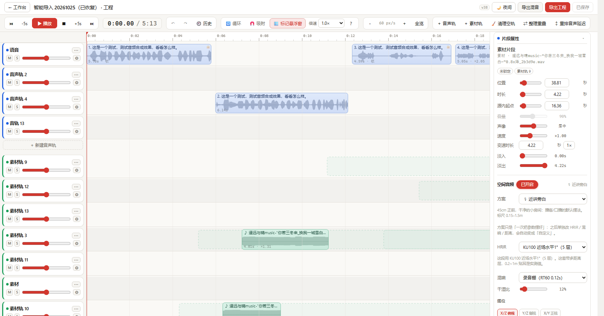
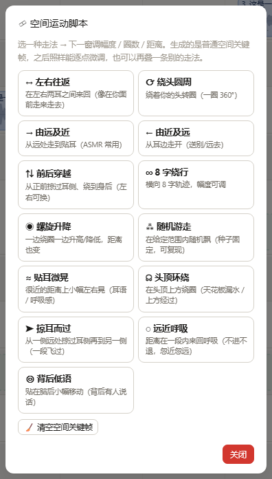
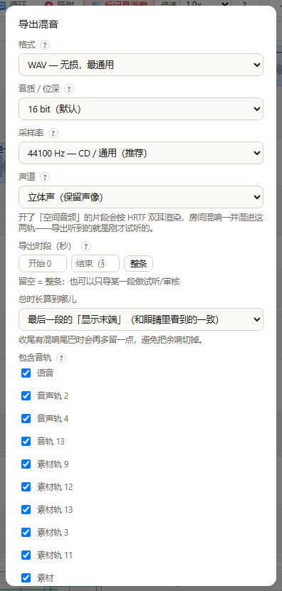
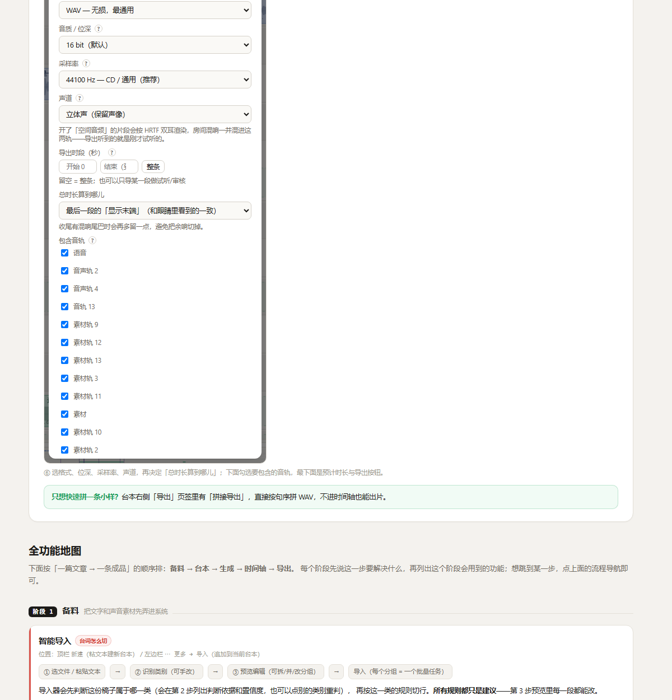

# 全能音声工作台 · IndexTTS2 长篇台本与全流程音声制作扩展


**从一份台本，到一部完整的音声作品。**

长篇台本管理、批量 AI 配音、多轨时间轴、音效编排、空间音频、自动化混音、专业工程导出 —— 将原本分散在多个软件和繁琐手工操作中的音声制作环节，整合进一套连贯的工作流。

本项目基于 **IndexTTS2.0 超级优化整合包 V3** 开发，为其扩展长篇台本工作台与多轨音频制作能力。它不是独立的 TTS 模型，也不只是一个批量配音工具，而是面向**有声书、广播剧、ASMR、角色音声、游戏语音及视频解说**等场景的全流程音声制作工作台。

<sub>当前版本 v0.33 · 2026-11-04 · Windows 便携整合包 · MIT（仅本项目代码）· 简体中文界面</sub>

## v0.33 这一版在解决什么

**方向：把「AI 配音」做成「可以直接交付的音声作品」。**

前面几版已经把手上的活串成了一条线（整理台本 → 批量生成 → 多轨时间轴 → 空间音频 → 混音导出）。
这一版补的不是新花样，而是这条线最容易翻车的两段：**配音改完之后编排还在不在**，
以及**一次处理几百上千条时会不会悄悄出错**。

### 一、换了音色，音效还该站在原来那句旁边

最真实的场景不是「从零做一条音声」，而是**原片已经剪好、音效也对好了位置，现在只想换个人声重录**。
难点在于换音色必然改变时长 —— 实测一条 71 秒的片段重录后变成 81 秒，
单句最长变成 2.94 倍、最短只剩 0.45 倍。如果音效按秒数硬搬，第 44 秒的关门声就会跑到别的句子上。

现在的做法是**按字幕序号对位，不按秒数**：

1. 先判断这个音效落在**第几条字幕**里（用你载入的那份 srt 判）；
2. 再找工程里**同一条字幕**对应的那句；
3. 按句内相对位置放回去（句内 70% 的位置，放回去还是 70%）。

句子长了短了都不影响，因为参照物是「哪一句」而不是「第几秒」。实测 26 段测试音效
（每句 30% / 70% 各一个）**26/26 全部落在对应句内，句内相对位置一分不差**。

### 二、批量操作不能靠运气

一次存几百段、导上千行，序号和速度都会暴露问题：第 100 个文件叫 `_100`，按名字排序
反而插到 `_10` 后面，外部软件按文件名合并就断在第 100 个；每存一段都重写整份索引，
100 段要两分钟。现在编号位数跟着这一批的总数走（120 段 → `_001…_120`），
索引整批只读写一次（1005 段 4.9 秒）。

### 三、出错要能当场看见

对位最怕的不是报错，而是「看起来成功了，其实整体偏了两句」。所以现在会：

- **自己判断**你手上的素材是哪一版（原片还是重录后的），判断结果写在预览顶部，不用你选；
- 字幕和素材**不是同一版**时直接提示（「这份字幕到 1:19，当前素材 1:12，两者不是同一版」）；
- 每段预览都写清「第几句 / 句内 +几秒 / 目标时间」，写入和预览走同一段代码，不会嘴上说一套。

### 四、人声分离：不是一个 BS 模型，而是一套可插拔的后端

这一版接的是 [**pymss**](https://github.com/ZFTurbo/Music-Source-Separation-Training)
（Music-Source-Separation-Training，MIT）推理后端 + 一个模型目录 `vendor2/roformer/`。
放进什么模型就跑什么，代码不绑定某一个权重：

| 能跑的架构 | 说明 |
|---|---|
| **BS-Roformer**（`bs_roformer`） | 主力。Band-Split + RoPE 注意力，人声分离目前的第一梯队 |
| **Mel-Band Roformer** | 梅尔刻度分带，人声隔离更细，模型更大更慢 |
| **BS-PolarFormer / BS-Conformer** | 同家族变体，权重出了就能直接用 |
| MDX23C / SCNet / HTDemucs / VR | 老模型也能挂进来，用来对照或救急 |

随包只带 **Demucs**（80MB，开箱可用）；BS 系权重自备（275MB 起），放进目录后
在导入台「BS-Roformer 模型」里点一下重新检测即可。处理链是
**BS-Roformer → Demucs → 中置提取**，选的那个挂了会自动往下退，不会卡住整个流程。

相关链接：

- 论文：[Music Source Separation with Band-Split RoPE Transformer](https://arxiv.org/abs/2309.02612)（ByteDance，2023）
- 架构实现：[lucidrains/BS-RoFormer](https://github.com/lucidrains/BS-RoFormer)（MIT，只有网络定义，不含权重）
- 训练框架 + 权重发布：[ZFTurbo/Music-Source-Separation-Training](https://github.com/ZFTurbo/Music-Source-Separation-Training)
- 权重清单：[docs/pretrained_models.md](https://github.com/ZFTurbo/Music-Source-Separation-Training/blob/main/docs/pretrained_models.md)
- 国内镜像 / 常用权重：[ModelScope · baicai1145/pymss](https://www.modelscope.cn/models/baicai1145/pymss) · [HuggingFace · baicai1145/pymss](https://huggingface.co/baicai1145/pymss)
- 社区权重合集（safetensors，需自行转 ckpt）：[AEmotionStudio/roformer-models](https://huggingface.co/AEmotionStudio/roformer-models)

> 逐条改动明细见 [CHANGELOG.md](CHANGELOG.md)（v0.23 ～ v0.32 合并为本版发布）。

<details>
<summary><b>历史版本条目（v0.20 ～ v0.32，点击展开）</b></summary>

> **v0.32（2026-11-04）** — 换音色后音效对位（用新片段实测）：
> ① **实测结论**：原片 71 秒、换音色后 81 秒（单句最长 2.94 倍、最短 0.45 倍），
>    每句 30% / 70% 各切一个测试音效，**26 段全部落在对应句内，句内相对位置分毫不差**。
> ② **修正一条错规则**：字幕要跟**素材**同源，不是跟工程同源 —— 素材是原片就载原片 srt，
>    素材是工程导出的混音才载工程字幕。混了会整段错（13 句错 10 句），帮助与文档已改写。
> ③ **「素材时间」默认自动**：拿素材总长比「字幕末尾 / 台本原片时间末尾」，自己判断该按哪套算，
>    判断结果写在预览里；手动选了错的仍会给出针对性警告。
> 逐条明细见 [CHANGELOG.md](CHANGELOG.md)。
>
> **v0.31（2026-11-04）** — 对位更准 + 库更好用：
> ① **按字幕序号对位**：不再只按绝对时间算 —— 先判「音效落在第几条字幕」，
>    再找工程里同一条对应的那句。换音色后整句变长变短，音效仍然跟着这句话；
>    载入的字幕和工程不同源时会明确警告（预览顶部写「按序号 43/43 对上」或「只能按时间」）。
> ② **输出与对位重写成可照做的流程**：入库三步 + 对位四步 + 四条注意事项
>    （句子别增删、字幕别改、别用工程导出的 srt、改完句子先刷新时间轴）。
> ③ **存入默认按这批建文件夹**：文件夹名 = 素材名，几十段一次进同一个夹子。
> ④ **音色库 / 音效库支持多选**：勾选框 / Ctrl 点选 + 批量条（移动 / 加标签 / 置顶 / 删除），
>    右键已选条目菜单顶部直接是批量动作；新增 `/refs/bulk`、`/sfx/bulk` 一次读写索引。
> ⑤ 修掉「高级音频处理台」入口偶发点不动（以前要先打开一次素材导入台才绑上事件）。
> 逐条明细见 [CHANGELOG.md](CHANGELOG.md)。
>
> **v0.30（2026-11-04）** — 批量编号与入库性能：
> ① **序号不再错位**：一次存/导上百个音频时，自动编号改成「按这批总数补位」
>    （120 段 → `_001`…`_120`，1005 段 → `_0001`…`_1005`）——原来固定两位，
>    第 100 个会叫 `_100`，按名字排序插到 `_10` 后面，外部软件合并素材就乱在第 100 个。
> ② 时间轴「按字幕对位」写入工程的片段名、单句 ZIP / 工程包里的音频名同样按总量补位。
> ③ **老库也顺**：导出列表、时间轴素材、主程序示例、文件夹 chips 都改成自然排序
>    （1、2、10，而不是 1、10、2）。
> ④ **批量入库提速两个数量级**：索引改成「整批只读写一次」——120 段 1.9 秒、
>    1005 段 4.9 秒（原来 100 段就要 2 分钟）；导入台批量清理的回收站清单也一次写完。
> 逐条明细见 [CHANGELOG.md](CHANGELOG.md)。
>
> **v0.29（2026-11-04）** — 导入原稿修正 + 说话人一键分组 + 界面收尾：
> ① **原文本预览不再重复**：`source_head` 只取正文之前的【场景】/【人物】/【字数】，
>    老台本里的重复头行前端也会滤掉（打开就正常，不用重导）。
> ② **「⤓ 导入原稿」下载的是真原文**：导入时把你的原稿原样存进台本目录，
>    带【场景】、角色前缀、时间码，一个字不改；老台本退回拆句版并提示。
> ③ **智能导入第 2 步新增「🎭 识别说话人 · 分组 · 分音色」**（在「高级识别」旁边）：
>    认人 → 按角色分组 → 按人物库套音色，一次做完。
> ④ **设置四块各自可折叠**（人物标签 / 时间轴 / 混音导出 / 参数预设），状态会记住，
>    「保存设置」固定在最下面。
> ⑤ **入口下移换浅绿**：「高级音频处理台 / 模型拓展」挪到导入台最底部，主入口改浅绿，
>    顶栏那颗同样；**高级音频处理台整页补上夜间模式**（含日/夜切换按钮、波形重绘）。
> ⑥ 识别弹窗的「选音色」下拉不再写死 150px，长音色名完整显示。
> 逐条明细见 [CHANGELOG.md](CHANGELOG.md)。
>
> **v0.28（2026-11-04）** — 剧本识别与标签体系补完：
> ① **一行时间码不再吃掉整篇剧本**：只有零散时间码时至少 2 条才判字幕；新增
>    `【场景】/【人物】/【字数】` 元信息识别，`【人物】` 解析成角色卡（带属性标签）并可一键建进人物库；
>    原文本预览保留原文，不再丢字。
> ② **属性面板说清音色来源**：「当前生效音色 · 来自人物 / 属性标签 / 这一句 / 台本默认」，
>    设置里写明音色优先级。
> ③ **标签库可自定义**：属性标签 27 个预设、音效标签 27 个预设，都能在设置里增删；
>    音色标签弹窗也能直接打开标签库。
> ④ **人物标签与音效标签彻底分开**：句中/句间弹窗标题带「音效」，附说明与人名 👤 标记。
> ⑤ 识别结果弹窗加宽到 720px，下拉不再截断；「高级音频处理台」改成醒目的主题色大入口，
>    工作台顶栏也加了一颗。
> 逐条明细见 [CHANGELOG.md](CHANGELOG.md)。
>
> **v0.27（2026-11-03）** — 把「角色 → 音色」从音色的标签里拿出来，做成**跨台本的人物库**：
> ① 设置最上层新增「**人物标签**」：一个人物 = 一个人名标签（唯一）+ 别名 + 多个属性标签 + 绑定音色；
>    列表可直接改绑定、「从当前台本分组新建」、搜索、看当前台本用了几句；
> ② 智能导入时**先按人名匹配**（含别名 / 去括号 / 拆前缀），命中就用人物绑定的音色；
>    人名没命中才回落到音色上的**属性标签**；
> ③ 「智能导入时按人物自动设音色」改为全局设置（默认开）—— 换章节不用重新勾；
>    已经导好的台本用「🧠 智能识别人物」重对，没绑音色的可当场绑定、没对上的可当场建人物。
> ④ 和工程里的「标签」（句中 / 句间时间点）明确区分：名字、位置、说明都不混。
> 逐条明细见 [CHANGELOG.md](CHANGELOG.md)。
>
> **v0.26（2026-11-03）** — 让「角色」直接对上「音色」：
> ① **音色可以打标签**（角色名），音色库多了标签筛选条，搜索也匹配标签；
> ② **智能识别人物**：智能导入按「阿澈：…」分好组之后，分组名和标签一致就自动套那个音色 ——
>    预览里能先看到「阿澈 → 青年音A」，勾一下再导入；已经导好的台本在
>    「设置 → 台本默认参数 → 🧠 智能识别人物」一键重对，没对上的角色可以直接挑音色打标签；
> ③ **只改音色**：情感、停顿、采样一律不动；已单独指定过音色的句子默认保留。
> 逐条明细见 [CHANGELOG.md](CHANGELOG.md)。
>
> **v0.25（2026-11-03）** — 高级音频处理台（原「高级音效处理台」）从「切音效」长成一条完整链路：
> ① **处理可选** —— 第 2 步不再写死「去人声」：留伴奏 / 留人声（去伴奏）/ 原样，三选一；
>    第 1 步还能「＋ 直接加入」本机文件，不用先回导入台。
> ② **片段能修** —— 工具条「⚙ 处理选中」把导入台那套搬进来了：首尾静音 / 淡入淡出 / 音量 /
>    变速 / 变调 / 标准化 / 降噪 / 高低通 / 反向，选多段就是批量；每段也能直接存音色库 / 音效库。
> ③ **按字幕对位进工程** —— 工作台从 SRT 导入台本后，处理台可以直接用那份台本的时间码，
>    按「每条字幕 [t0,t1] → 中文那句片段 [起,止]」对位；先「🔎 对位预览」看每段落在第几句，
>    再「写入工程」，或者直接点「⚡ 一键全流程」跑完四步。
> 逐条明细见 [CHANGELOG.md](CHANGELOG.md)。
>
> **v0.24（2026-11-03）** — 素材一多就不好用的问题，这一轮从「库」这一层解决：
> ① **三个素材库都有文件夹**（音色 / 音效 / 导入台），工作台、时间轴、高级音效处理台共用同一套目录；
>    文件夹只是索引里的一个字段，不搬文件 —— 移动 / 改名毫秒级，删文件夹绝不删音频。
> ② **高级音效处理台补齐编辑手感**：独立播放头条（拖播放头不再和圈选抢手势）、每条轨左上角的状态胶囊与
>    播放/静音/音量、播放键点一下变暂停；修掉「去掉人声后第 3 块永远是灰的」。
> ③ **处理方案可存可回**：分离参数 + 切分参数 + 手工片段打包保存，重新切分前先确认并自动兜一份，
>    撤销 / 重做连「重新切分」这一步也能回。
> ④ **情感面板按模式展开**：选哪个模式才展开哪一块，并补上模式 3 的情感描述文本（批量 / 分组 / 默认三处）。
> ⑤ **清理空间**跟上新产物（音效台作业、分离中间文件），并修掉一个会让服务退出的整目录删除。
> 逐条明细见 [CHANGELOG.md](CHANGELOG.md)。
>
> **v0.22（2026-11-01）** — 这一版**只做智能导入**，把它从「切得动」推到「看得清、改得动、追得回」：
> ① **认人更准** —— 新增可选的「🧠 高级识别」，按旁白里的名字（`「…」李四说`、`李四冷笑：`）判断每句谁说的，
>    认不出才退回 角色A/角色B；对白符号做成一张表（`[]` `【】` `《》` `{}` `「」` `『』` `“”` …）并可自定义，
>    方括号对白不再被误当成「括号备注」而全进旁白。
> ② **看得清** —— 新增**正文预览**：把导入后的样子连排成一份上了色的正文，同色 = 同组 = 同一音色，
>    不朗读的备注灰色不上色；一眼看出「哪几段会被念、哪几段不会」。
> ③ **改得动** —— 预览里可拖选半句单独去配音、可撤销恢复、右下角「保存并按预览分组」点下去才生效（关掉即丢弃）；
>    第 3 步的分组卡片同步标出「不配音（不进台本）」。
> ④ **追得回** —— 「⤓ 导入原稿」下载的是**纯原文**（一段一行、不带格式），用来核对导入时有没有漏句，
>    也能拖回智能导入原样重来（分段方式选「一行一段」）。
> ⑤ 台本页新增 **📄 原文本预览 / 📝 当前文本预览**（一句一行带行号、切换停在同一句）、多选删除；
>    教程配图 12 → 25 张。
> 逐条明细见 [CHANGELOG.md](CHANGELOG.md)。
>
> **v0.20（2026-10-28）** — 0.19 之后按实机使用反馈连修 6 轮，合并成正式号：
> 修掉 **22 处缺陷**，其中 5 处会直接造成损失（「只生成选中行」其实把整篇都跑了、
> 渲染线程 `WinError 5` 中止、变速片段导出丢句、ASMR 近场破音、导出里每秒一声「嗒」）；
> 新增 **16 项**功能（分组编辑可直接加减句、生成中排队询问、完成汇总、每个渲染范围标句数等）。
> 改动 17 个文件 / +1468 −125 行（代码 +974 / −116），新增 89 项断言、53 套回归全绿。
> 逐条明细见 [CHANGELOG.md](CHANGELOG.md)。

</details>

> ⚠️ **这是扩展补丁，不是独立软件。** 必须先安装整合包 V3（提供模型与运行时），本仓库只提供工作台这一层代码。
> 整合包的下载方式与原作者信息见下方 [关于原项目与版权](#-关于原项目与版权)。

---

## ✨ 核心功能：从一份台本，到一部完整的音声作品

不止是 AI 配音。台本整理、批量生成、素材处理、多轨剪辑、空间音频、自动化混音与专业工程导出，一套工作流覆盖音声制作的主要环节。

### 01 · 整理台本，让长篇创作变得可控

再长的文稿，也能拆解成清晰、可管理、可批量处理的配音任务。

- **智能识别与分句** —— 支持时间轴稿、剧本、小说、指令和纯文本等不同类型的文稿，提供多种分行方案，可调整单段长度、分组方式和句间停顿。
- **灵活组织内容** —— 按章节、角色、场景或指定段数分组，支持逐段预览、拆分、合并和修改。
- **批量管理与重做** —— 支持单句生成、选中行批量生成、未生成内容补全及全文生成；可按状态、音色和分组筛选，并快速定位修改过的句子。
- **句内音效标记** —— 在指定文字之后或两句之间添加音效标记，设置延迟与留白，为后续时间轴编排做好准备。

<p align="center">


</p>

### 02 · 批量 AI 配音，逐句生成、试听与重做

让每一句台词都能独立管理，不必因为局部修改而反复处理整篇作品。

- **逐句独立生成** —— 每行台词对应独立的音频结果，可单独试听、重新生成和检查实际时长。
- **角色与音色管理** —— 按分组配置音色和情感参数，让不同角色、章节或场景采用各自的配音设置。
- **灵活批量生成** —— 可针对选中行、尚未生成的句子或全部台词执行生成，方便长篇内容分批制作。
- **修改追踪** —— 快速查看文本或生成状态发生变化的句子，减少查找与重复劳动。
- **多选与批量操作** —— 支持连续或非连续多选、批量删除和复制；复制句子时可连同已有音频一起复制。

<p align="center">


</p>

### 03 · 导入与处理素材，建立自己的音色库和音效库

不只处理生成出来的声音，也能把已有录音、环境音和视频素材纳入制作流程。

- **多种素材导入** —— 支持音频和视频素材，视频可提取音轨作为后续处理的原始素材。
- **常用音频处理** —— 提供去伴奏、中置提取、降噪、响度标准化与音频裁剪等功能。
- **素材分类沉淀** —— 将处理后的音频保存到音色库或音效库，供后续配音和时间轴工程复用。
- **文件夹归类** —— 三个库都支持多级文件夹（工作台 / 时间轴 / 音频处理台共用一套目录），
  几百条素材也能按场景找；列表分批渲染，不卡。
- **人物库（跨台本）** —— 一个人物 = 人名标签（唯一）+ 别名 + 多个属性标签 + 绑定音色；
  智能导入先按人名匹配、命中即用它的音色，人名没命中才看音色上的属性标签
  （只改音色，情感与停顿不动）。同一本书换章节不用重新设。
- **按字幕对位** —— 同一份 SRT 既生成台本、又用来切音效；写进时间轴时按「句子局部比例」换算，
  句内出现的音效仍落在那一句的同一位置（对位预览确认后再写入）。
- **保留原始素材** —— 默认保留原文件，便于重新处理、调整参数和制作不同版本。

<p align="center">

</p>

### 04 · 多轨时间轴，把台词和音效真正编排起来

从一条条独立音频，进入可以自由调整的多轨音声工程。

- **多轨素材编排** —— 分轨管理配音与音效等素材，支持拖拽移动、裁剪、框选、多选及整组移动。
- **台本与时间轴衔接** —— 从台本工作台创建工程副本，将句子和已有音频带入时间轴；原台本保持不变。
- **快速重排台词** —— 根据台本句序与句间停顿，重新排列分散在多条音声轨上的片段，只调整开始时间，不必重新生成音频。
- **精确调整片段** —— 可编辑片段位置、时长、源音频起点、音量、声像、淡入淡出和播放速度。
- **灵活控制时长** —— 支持变速播放，也可将音频调整到指定时长，方便匹配画面、动作和音效节点。

<p align="center"></p>

### 05 · 句内音效与空间音频，设计声音的距离和运动

不只是把声音放进时间线，还能控制它从哪里出现、如何移动，以及听起来处于怎样的空间。

- **精准插入音效** —— 台本中标记的句内位置、句间位置和延迟设置，可在进入时间轴时转换为对应的素材片段。
- **空间定位** —— 基于 HRIR 数据进行空间音频处理，支持方位、仰角和距离控制。
- **房间混响** —— 提供房间混响与干湿比调节，为声音增加空间感。
- **运动脚本预设** —— 内置 13 种运动脚本，可快速生成左右往返、绕头圆周、掠过耳侧、头顶环绕、背后低语等空间运动效果。
- **关键帧曲线** —— 为方位、仰角、距离等空间参数设计随时间变化的轨迹，塑造连续的声音运动。

<p align="center">


</p>
<p align="center"></p>

### 06 · 自动化控制与实时录制，让声音随时间变化

让音量、声像和空间位置不再是固定参数，而是可以随着剧情与听感动态变化的控制曲线。

- **三类自动化曲线** —— 支持音量、声像和空间距离关键帧。
- **边听边调整** —— 播放过程中操作控制滑杆，可将实时调整记录为关键帧。
- **精细塑造声音** —— 通过参数随时间变化，制作音量渐强渐弱、左右声道移动及距离远近变化等效果。

<p align="center"></p>

### 07 · 混音与工程导出，将制作成果交给专业软件

既能直接输出成品，也能保留可继续编辑的工程结构。

- **多格式混音** —— 支持 WAV、MP3、FLAC、OGG，可配置采样率、声道、导出时段和指定轨道。
- **REAPER 工程** —— 导出包含片段位置、裁剪、音量、声像、淡入淡出及自动化信息的工程，便于继续后期制作。
- **视频后期衔接** —— 支持导出 PR / 达芬奇 EDL，方便衔接视频剪辑工作流。
- **Audacity 工作流** —— 导出分轨 WAV 与标签，便于检查、修整和继续编辑。
- **完整素材交付** —— 可附带分轨 stems、`timeline.csv` 和 `markers.csv`，方便归档、复用和二次处理。
- **灵活控制导出范围** —— 可选择指定轨道与时间段，并按显示末端或未显示末端计算导出总时长。

<p align="center"></p>

### 08 · 内置离线教程，从首次使用到完整制作

不必反复查阅外部文档，工作台自带完整的操作指引。

- **六步上手流程** —— 从素材准备到最终导出，快速了解基本制作步骤。
- **完整功能索引** —— 按备料、台本、生成、时间轴、导出五个阶段组织功能说明。
- **快捷键与常见问题** —— 方便查找操作方法和排查常见问题。
- **离线阅读** —— 教程页面与配图随补丁提供，无需联网访问。

<p align="center"></p>

从台本到配音，从音效到空间运动，再到混音与工程交付 —— 这就是全能音声工作台希望提供的完整制作流程。

---

## 📦 项目性质

- **项目类型** —— IndexTTS2 扩展补丁，依赖 IndexTTS2.0 超级优化整合包 V3 运行，不是独立的 TTS 软件。
- **主要平台** —— Windows 便携整合包环境，提供简体中文界面。
- **核心用途** —— 长篇台本管理、批量语音生成、音效编排、空间音频、自动化混音与工程导出。
- **仓库内容** —— 只有工作台这一层代码（台本编辑器 / 时间轴 / 混音与工程导出 / 教程），
  **不含**模型、运行时与整合包本体。

## 🛠 关于本项目的开发

本项目的开发主要由我负责整体方向规划、功能构思、需求整理与开发指导，具体的代码编写和功能实现则大量借助 AI 工具 **DeepSeek** 完成。

如果你在使用过程中遇到问题，欢迎提交反馈；如果涉及我暂时无法独立解决的技术问题，可以尝试借助 AI 工具分析报错、排查问题或修改代码，也可以参考项目文档自行解决。

如果问题涉及基础整合包、模型或推理环境，建议优先向原作者 **十一君Jun** 请教。

本项目是个人业余项目，开发与维护能力有限，无法保证所有问题都能及时解决，还请见谅。

## 💛 关于原项目与版权

本项目仅提供扩展工作台相关功能，**不包含也不拥有**基础整合包、IndexTTS2 模型与推理代码的版权。相关组件及第三方素材均遵循各自的许可协议，具体请参阅 [LICENSE](LICENSE)、[CREDITS.md](CREDITS.md) 及相关说明文件。

基础整合包（**IndexTTS2.0 超级优化整合包 V3**，作者：B 站 **十一君Jun**）及其相关问题，请优先参考原作者发布的信息：

- GitHub：<https://github.com/lfandrh/indextts2-studio>
- B 站主页：<https://space.bilibili.com/470166715/>
- 整合包相关视频：<https://www.bilibili.com/video/BV18AJX6SEBN/>


> 如果你是第一次知道这个整合包：**请先感谢并支持原作者**。整合包本体的一切问题（模型、显存、安装、更新）
> 都应该去原作者那边反馈，而不是本仓库。
>
> 感谢原作者 **十一君Jun** 提供的基础整合包，也感谢 **DeepSeek** 等 AI 工具在本项目开发过程中提供的帮助。

---

## 🚀 快速开始

### 方式一：装补丁包（推荐，最省事）

1. 先准备一个 **IndexTTS2.0 超级优化整合包 V3**（见上方[下载链接](#-关于原项目与版权)），确认能正常启动；
2. 下载本仓库 [Releases](https://github.com/Mars-1438/indextts2-longform-workbench/releases) 里的
   `indextts2-longform-workbench-patch-vX.Y.zip`（约 119MB）；
3. 把 zip **解压到整合包根目录**（和 `server.py`、`runtime\` 同级），会多出一个 `IndexTTS2_全能音声工作台补丁_vX.Y` 文件夹；
4. 进这个文件夹，双击 **`安装.bat`**；
5. 看到「完成」后关掉窗口，重新双击整合包根目录的 `start_server.bat`；
6. 浏览器打开首页，右上角会多一个「长篇台本」入口；也可以直接访问：
   - `http://127.0.0.1:7860/longform` —— 台本工作台
   - `http://127.0.0.1:7860/timeline` —— 时间轴
   - `http://127.0.0.1:7860/guide` —— 图文教程

安装器做的事只有三件，都可以手工完成：把文件铺进整合包、在 `server.py` 里插一段扩展注册、在 `web/index.html` 里加入口。
它**不会**改你的模型、不会动既有页面（除了 `index.html` 加一行链接），失败也不会拖垮主服务。想卸载跑 `install.py --restore`。

> 补丁包里带了两样「大件」：`bin\ffmpeg.exe`（视频抽音频）和 Demucs 的 htdemucs 权重（去伴奏，离线可用）。
> 不需要的话可以删掉 `bin\` 或 `vendor2\torch\`，功能会退化成「只能导入普通音频 / 只有轻量中置提取」。

### 方式二：从源码装（想改代码 / 移植到别的包）

见 [docs/移植到其它整合包.md](docs/移植到其它整合包.md)，里面有文件清单、注册块位置、依赖和踩坑记录。

---

## 🧭 三步上手

1. **导入台本**：顶栏「新建」→ 粘贴文稿 → 选分行方案 → 预览 → 导入。
2. **选音色并生成**：音色库选参考音频（或素材导入台里存一个）→ 右侧「生成」页签 → 先试 1~2 句 → 全篇生成。
3. **进时间轴**：台本页「🎬 时间轴」会新建一份工程副本（原台本不动）→ 排位置 / 加音效 / 调空间 → 「导出混音」。

更细的流程都在工作台自带的教程里（`/guide`，点顶栏「🎓 第一次用？看看这里」）；
纯文字版见 [docs/使用说明.txt](docs/使用说明.txt)，实现细节见 [docs/技术路线_长篇台本与时间轴.md](docs/技术路线_长篇台本与时间轴.md)。

---

## 📦 目录结构（本仓库）

```
longform_api.py        台本工作台后端（FastAPI 路由 /api/v1/lf/*）
lf_import.py           智能导入：五类识别 + 分行规则
timeline_api.py        时间轴后端（路由 /api/v1/lf/tl/*、混音与工程导出）
hrir.py                SOFA / NPZ 的 HRIR 读取、打包与查询
rooms.py               房间混响（IR 生成 / 卷积）

web/                   前端
  longform.html/.css/.js    台本工作台
  timeline.html/.css/.js    时间轴
  emoctl.js                 情感控件（两个页面共用）
  guide.html + guide/*.png  内置教程与配图

assets/hrir/           HRIR 数据（KEMAR / KU100 近场；授权见该目录 README）
packaging/             补丁安装器（install.py / 安装.bat / 说明.md）
tools/
  make_patch.py           打补丁包的脚本
  fetch_ffmpeg.ps1        可选：下载 ffmpeg 到 bin/（不把二进制放进仓库）
docs/                  使用说明、技术路线、移植指南、补丁安装说明、README 配图
```

---

## ✅ 兼容性与已知限制

- **平台**：主要针对 **Windows 便携整合包**（自带 `runtime\python.exe`）。安装器与 `.bat` 是 Windows 脚本；
  Linux/macOS 需要手工铺文件 + 自己装依赖（见移植指南）。
- **Python**：3.11（整合包内置）。后端只依赖 `fastapi / numpy / soundfile`，`scipy / h5py / torch+demucs` 是可选项。
- **主程序版本**：按 IndexTTS2 v3 的 `server.py`（`app` + `api = APIRouter(...)` + `/api/v1`）写的注册逻辑；
  别的改版整合包结构不同的话要按移植指南改接线。
- **数据是纯文件**：台本 / 工程 / 素材 / 导出都在整合包的 `longform\` 与 `outputs\` 下，不写注册表、不写系统目录。
- **不做的事**：不训练模型、不替换 TTS 推理、不改主界面既有功能；工作台只是「上游 API 的编排层」。
- **性能**：空间音频 + 混响是实时渲染（numpy/scipy），一小时工程导出混音大约几分钟，具体看机器。

---

## ⚖️ 许可与使用边界

- 本仓库中**由本项目作者编写的代码**以 **MIT** 发布，见 [LICENSE](LICENSE)。
- **不包含也不授权**：IndexTTS2 模型与推理代码、十一君Jun 的整合包、Demucs 权重、ffmpeg 二进制。
  这些各自的版权与许可见 [CREDITS.md](CREDITS.md)。
- **HRIR 数据**：`assets/hrir/` 下不同文件授权不同（KEMAR 无使用限制但需引用；KU100 近场为 CC BY-SA），
  详见该目录内的 `README.md`。商用前请自行确认。
- **使用边界**：本项目用于个人创作与学习。请勿用于伪造他人声音、诈骗、侵权或任何违法用途；
  公开发布合成语音时，请遵守当地关于 AI 生成内容标识的规定，并取得声音权利人的授权。
- **免责**：软件按「现状」提供，不附带任何担保；因使用本软件产生的任何后果由使用者自行承担。

---

## 🙏 致谢

- **十一君Jun** —— IndexTTS2.0 超级优化整合包 V3 的作者，没有这个包就没有本项目。
- **IndexTTS2 / 哔哩哔哩** —— 语音合成模型与推理框架。
- **DeepSeek** —— 本项目开发过程中大量使用的 AI 辅助工具。
- **Meta AI / Demucs**、**MIT Media Lab（KEMAR）**、**TH Köln（KU100 近场 HRIR）**、**FFmpeg** —— 见 [CREDITS.md](CREDITS.md)。

---

## ❓ 常见问题

**Q：必须先装整合包吗？能不能单独跑？**
A：必须。工作台不含模型和推理代码，它调用的是整合包里的 TTS。装好整合包再装补丁即可。

**Q：点生成没反应 / 一直「加载模型」？**
A：第一次生成要加载模型，慢的话几十秒。状态灯（右侧顶部）从灰变绿才好；一直不动看 `logs\server.log` 最后几行。

**Q：拖视频进导入台没反应？**
A：需要 ffmpeg。补丁包已内置；源码安装请把 `ffmpeg.exe` 放进 `bin\`，或在导入台底部「✎ 填路径」指定。

**Q：能商用吗？**
A：代码是 MIT，但**模型、整合包、Demucs 权重、HRIR 数据各有各的许可**（见 CREDITS）。商用前请逐项确认；
声音克隆本身还涉及声音权利人的授权。

**Q：能移植到别的 TTS / 别的整合包吗？**
A：理论上可以，写个适配器就行，见 [docs/移植到其它整合包.md](docs/移植到其它整合包.md)。

---

## 📮 反馈

- 工作台本身的 bug / 建议：个人业余项目，更推荐去找蓝色大肥鱼
- 整合包、模型、安装环境的问题：请找原作者。

> 
